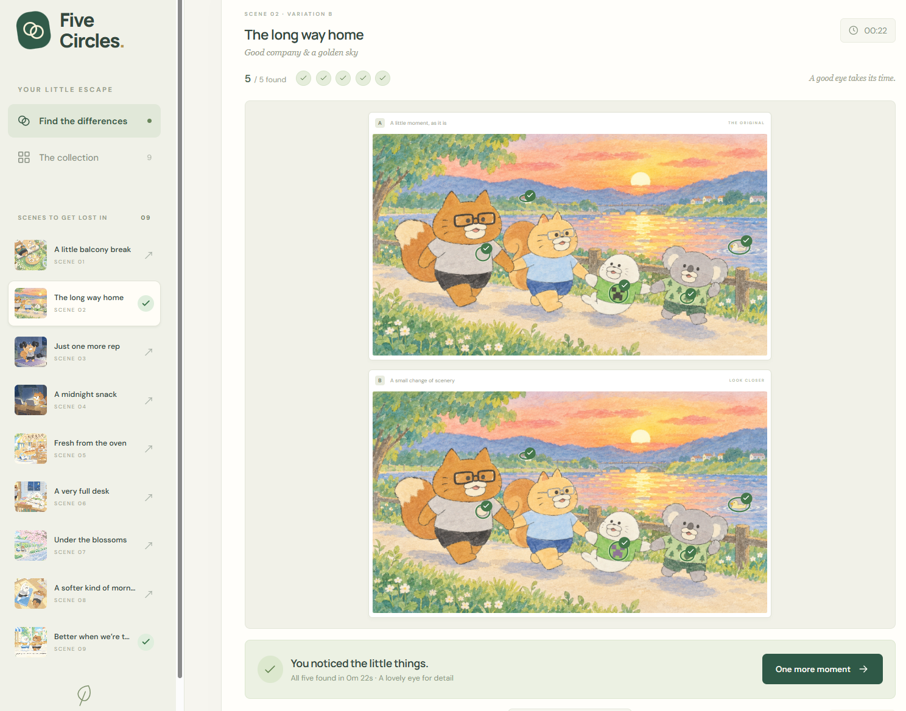

# Five Circles



A responsive, browser-based find-the-differences game built with Vite, TypeScript, and plain CSS.

## Run locally

Requires Node.js 20.19+ or 22.12+.

```sh
npm install
npm run dev
```

Open the printed local URL. To play on a phone connected to the same Wi-Fi, open the printed Network URL. Production output is created by `npm run build`; `npm run preview` serves it locally.

## Playing

- The 9 supplied illustrations each have 2 variants: **18 rounds**, with **exactly 5 difference regions per round**.
- A round compares one original with one randomly chosen variant of the same illustration. Comparing unrelated scenes or the two variants would produce an invalid puzzle.
- Landscape illustrations stack vertically. The portrait illustration appears side by side, including on phones.
- Tap/click either image to find a difference. Found details are circled in both pictures and repeated taps count only once.
- Drag to pan after zooming, use the mouse wheel or a two-finger pinch to zoom, or use the zoom buttons. Both images share one normalized camera transform.
- Shift + wheel pans horizontally. Focus a picture for arrow-key panning, + / − zoom, and 0 to reset.
- Hints center and highlight an unfound detail. Progress, current round, completed rounds, and time are saved in localStorage on the current device.
- There is no time limit or penalty. The timer pauses while the tab is hidden or a dialog is open.

## Puzzle data and images

- `assets/`: the original supplied PNGs, unchanged.
- `public/images/`: 9 lossless WebP originals, 18 finished variants, and 9 lightweight collection thumbnails. These are the images used by the game.
- `public/data/puzzles.json`: all 18 rounds and their answer coordinates. `x`, `y`, and `bounds` use normalized image coordinates from 0 to 1. `pixelBounds` stores the exact source-pixel rectangle. Each difference has a stable ID and human-readable label.
- `assets/generation-prompts.json`: the prompt set and built-in image generation provenance.
- `scripts/image-plan.mjs`: scene definitions, planned edits, and corrected bounds matching the actual generated changes.

The variants were edited with the built-in image generation tool. Only the five measured regions from each generated result were composited into the untouched source, with a three-pixel feathered edge. Lossless output guarantees **zero changed pixels outside those five regions**. Each region was visually reviewed; pixel checks alone cannot prove a semantic difference.

The final image files and JSON are self-contained; running the game never calls an image-generation service. Rebuilding the images with `node scripts/prepare-assets.mjs` additionally needs the local generation-path manifest and the original generated outputs referenced there. The ignored manifest is specific to the authoring machine and is unnecessary for normal install/build/deployment.

## Verification

```sh
npm test                 # camera transforms, hit coordinates, bounds, shuffle
npm run validate:assets   # dimensions, five non-overlapping regions, no edits outside them
npm run test:browser      # desktop + phone browser tests (start npm run dev first)
npm run build            # strict TypeScript check and production build
```

Browser tests use installed Google Chrome by default. Set `PLAYWRIGHT_CHANNEL=msedge` to use Edge, or install Playwright Chromium and set `PLAYWRIGHT_CHANNEL=chromium`.

No backend or account is required. Google Fonts are optional; system fonts are used when unavailable.
